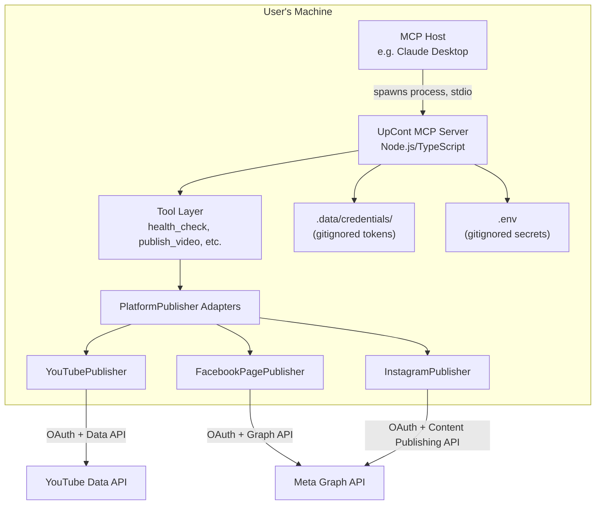
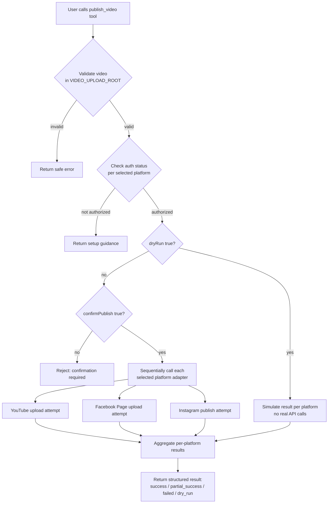

## Architecture



## Video Publishing Flow




## Local HTTPS setup for Facebook and Instagram OAuth

UpCont uses a temporary local HTTPS callback server to complete Meta OAuth.

### Why HTTPS is needed

Meta may reject an HTTP redirect URI such as:

```text
http://127.0.0.1:53683/meta/oauth/callback
```

The error may appear as:

```text
Facebook has detected that UpCont isn't using a secure connection
to transfer information.
```

The Meta dashboard may also display:

```text
HTTPS is required for all redirect URLs.
```

For this setup, use:

```text
[https://localhost:53683/meta/oauth/callback](https://localhost:53683/meta/oauth/callback)
```

Changing the redirect URI alone is not enough: the callback helper must actually serve HTTPS using a locally trusted certificate.

This does not change UpCont's local-first architecture:

- MCP communication still uses stdio.
- The OAuth callback listener runs only on your computer.
- OAuth credentials remain in your local token store.
- No public deployment, public tunnel, or central database is required.

### Prerequisites

- Windows 11
- Node.js and npm
- Windows Package Manager (`winget`)
- UpCont installed locally
- Your own Meta developer app
- Your own local `.env` file

Run the following commands from the UpCont project root.

### 1. Install mkcert

`mkcert` generates development certificates that your computer can trust.

```powershell
winget install --id FiloSottile.mkcert -e
```

After installation, close PowerShell and open a new terminal so the updated PATH is available.

Verify:

```powershell
mkcert -version
```

### 2. Install the local development certificate authority

```powershell
mkcert -install
```

Windows may ask for permission to install the local development certificate authority.

This modifies your computer's local trust settings. Only run this command with a copy of mkcert obtained from a trusted source.

### 3. Generate the localhost certificate

Create the ignored certificate directory:

```powershell
New-Item -ItemType Directory -Force .\.data\certs
```

Generate the certificate and private key:

```powershell
mkcert `
  -key-file .\.data\certs\localhost-key.pem `
  -cert-file .\.data\certs\localhost.pem `
  localhost 127.0.0.1 ::1
```

Expected files:

```text
.data/
└── certs/
    ├── localhost-key.pem
    └── localhost.pem
```

Each user should generate their own local certificates. Do not distribute a developer's private key with the repository.

### 4. Configure the redirect URI

Add or update the following value in your local `.env`:

```env
META_REDIRECT_URI=[https://localhost:53683/meta/oauth/callback](https://localhost:53683/meta/oauth/callback)
```

The default local token path is:

```env
META_TOKEN_PATH=.data/meta-token.json
```

UpCont locates the certificate directory next to the configured token file:

```text
<token-file-parent>/certs/localhost-key.pem
<token-file-parent>/certs/localhost.pem
```

For the default token path, this resolves to `.data/certs/`.

If you customize `META_TOKEN_PATH`, place the certificate files in the corresponding adjacent `certs` directory.

### 5. Configure the Meta developer dashboard

In your Meta app, open the settings for Facebook Login or Facebook Login for Business.

Add this exact value under Valid OAuth Redirect URIs:

```text
[https://localhost:53683/meta/oauth/callback](https://localhost:53683/meta/oauth/callback)
```

The dashboard value and `.env` value must match exactly, including:

- Protocol: `https`
- Hostname: `localhost`
- Port: `53683`
- Path: `/meta/oauth/callback`
- No trailing slash

Do not substitute `127.0.0.1` in just one location.

### 6. Required callback-server implementation

These instructions assume UpCont's HTTPS callback implementation is installed.

The Meta OAuth helper must:

- Use `createServer` from `node:https`.
- Load `localhost-key.pem` and `localhost.pem`.
- Validate that the configured redirect URI uses HTTPS and localhost.
- Bind the listener to the local loopback interface.
- Verify OAuth `state` before exchanging an authorization code.
- Shut down the temporary listener after completion or timeout.

If your checkout still imports `createServer` from `node:http`, changing `.env` will not enable HTTPS. Update the callback implementation before continuing.

### 7. Build and restart UpCont

```powershell
npm run typecheck
npm test
npm run lint
npm run build
```

Completely restart your MCP client so it launches the updated server and reloads the environment configuration.

For MCP Inspector:

```powershell
npx @modelcontextprotocol/inspector node .\dist\index.js
```

### 8. Start a fresh OAuth session

Call the following MCP tool:

```text
meta_start_oauth
```

Input:

```json
{}
```

Open the newly returned authorization URL in your browser.

Do not reuse an old authorization URL. Each authorization attempt uses a new OAuth state value associated with the running callback helper.

Complete the Meta login and approve the required account and asset access.

### 9. Optional HTTPS connectivity check

After calling `meta_start_oauth`, while the callback listener is active, open:

```text
[https://localhost:53683/](https://localhost:53683/)
```

Expected response:

```text
Not found.
```

This is normal: UpCont does not provide a homepage at `/`.

The important check is that the browser reaches the local server without a certificate warning.

Then open the fresh Meta authorization URL to complete OAuth.

The callback listener is temporary. Opening this address before starting OAuth, or after the listener has closed, may produce a connection-refused error.

### 10. Verify authorization

Call:

```text
meta_oauth_status
```

Input:

```json
{}
```

After successful authorization, the response should contain:

```json
{
  "state": "authorized"
}
```

Verify that the local token file exists:

```powershell
Test-Path .\.data\meta-token.json
```

Expected:

```text
True
```

Verify that runtime credentials and certificate files are ignored by Git:

```powershell
git check-ignore `
  .\.data\meta-token.json `
  .\.data\certs\localhost-key.pem `
  .\.data\certs\localhost.pem
```

Each path should be printed.

## Local certificate and credential safety

Ensure `.gitignore` includes:

```gitignore
.env
.data/
```

Never commit or share:

- Meta App Secret
- OAuth access tokens
- Local token files
- `localhost-key.pem`
- mkcert's root CA private key

mkcert's root CA files are stored separately from the project's `.data` directory. Ignoring `.data/` does not protect files copied from that separate location.

Do not configure:

```env
NODE_TLS_REJECT_UNAUTHORIZED=0
```

Disabling TLS verification is not a solution to certificate errors.

This certificate setup is for local development. It is not a certificate or deployment strategy for a publicly hosted service.

## Troubleshooting local Meta HTTPS

| Problem | Check or fix |
|---|---|
| `mkcert` is not recognized | Open a new terminal after installation and verify with `mkcert -version`. |
| Certificate file `ENOENT` error | Check the `certs` directory adjacent to the configured token file. |
| Browser certificate warning | Confirm `mkcert -install` succeeded, confirm the certificate includes `localhost`, and restart the browser. Do not bypass the warning as the normal setup procedure. |
| `EADDRINUSE` on port `53683` | Stop the previous OAuth helper or MCP process before retrying. |
| Connection refused | Call `meta_start_oauth` first; the HTTPS callback server is temporary. |
| Redirect URI mismatch | Match the dashboard and `.env` values exactly, including protocol, hostname, port, path, and trailing slash. |
| Dashboard still rejects HTTP | Use the HTTPS callback URI; do not try to disable HTTPS enforcement. |
| OAuth state validation failed | Start a fresh OAuth attempt and use its newly generated authorization URL. |
| HTTPS works, but Meta login still fails | Check app roles, login configuration, permissions, and selected Page/Instagram assets separately. HTTPS only fixes the callback transport. |